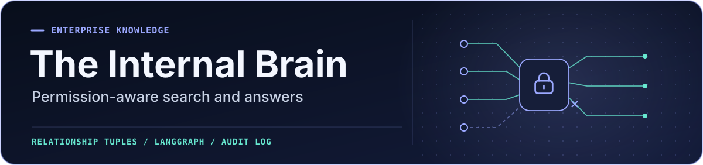
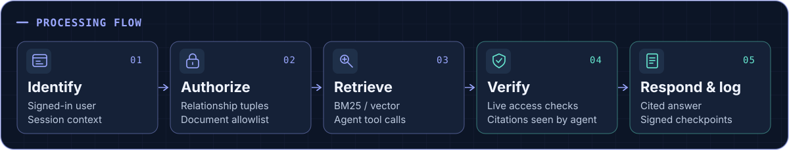

<p align="center">
  
</p>

# The Internal Brain

Search simulated Confluence, Jira, Slack, and Google Drive content with the signed-in user's current permissions. The assistant filters documents before retrieval, checks citations before responding, and records tool calls and answers in a tamper-evident audit log. [Open the hosted demo](https://permission-aware-kb.app.workbuddy.host) · [Read the five captured scenarios](docs/scenarios.md)

## Retrieval benchmark

```console
$ python evaluate.py --retriever bm25 --unit chunk --no-save

| mode        | recall@3 | leak(all) | probe_leak |
| no_acl      |    88.9% |     52.3% |      94.6% |
| post_filter |    88.9% |      0.0% |       0.0% |
| pre_filter  |    89.5% |      0.0% |       0.0% |
```

Selected columns from the BM25 benchmark on 91 simulated documents and 132 author-confirmed cases. Pre-filtering returned no inaccessible documents across 37 permission probes. In a separate 38-case `deepseek-chat` run, the full graph exposed **0 of 22 targeted canaries**, compared with **7 of 22** when both the search filter and the citation guard were disabled. Both benchmarks use a fictional company corpus. [Retrieval report](results/2026-10-16_203053.md) · [Agent report and ablations](results/2026-10-16_202237.agent.md)

## Architecture



Python enforces authorization at each tool call. The answer guard checks each citation against current permissions and the documents the agent actually saw. Follow-up turns also recheck previously cited documents after a permission change. [Trust boundary](docs/trust_boundary.svg) · [LangGraph definition](docs/agent_graph.mmd)

## Quick start

Run the BM25 benchmark from a fresh checkout with Python. This path uses the standard library and a local authorization backend.

```bash
python evaluate.py --retriever bm25 --unit chunk --no-save
```

For the local UI and agent tests, install the project dependencies. The UI defaults to the scripted model on a fresh checkout.

```bash
python -m venv .venv
source .venv/bin/activate
python -m pip install -r requirements.txt
python -m streamlit run app.py
```

## CLI reference

| Command | Output or action |
| --- | --- |
| `python evaluate.py --no-save` | BM25 retrieval benchmark and access-control comparison |
| `python evaluate.py --compare --no-save` | Compare BM25, vector, and hybrid retrieval on documents and chunks |
| `python evaluate_agent.py --no-save --no-export` | Run the agent benchmark and its ablation sweep |
| `python simulate.py --help` | List demo actions for document updates, revocation, and audit integrity |
| `python -m unittest discover tests` | Run local tests |
| `python scripts/capture_scenarios.py` | Regenerate the five scenario transcripts |

<details>
<summary>Model, authorization, and repository layout</summary>

Copy [`.env.example`](.env.example) to `.env` to configure a real model for chat and agent evaluation. Set `LLM_BASE_URL`, `LLM_MODEL`, and `LLM_API_KEY`. Vector retrieval uses the `EMBED_*` settings. `AUTHZ_BACKEND=local` uses the bundled relationship tuples. The OpenFGA backend uses `OPENFGA_API_URL`.

| Path | Role |
| --- | --- |
| [`app.py`](app.py), [`start.py`](start.py) | Streamlit UI and hosted entry point |
| [`authz/`](authz/), [`retrieval.py`](retrieval.py) | Authorization and candidate filtering |
| [`agent.py`](agent.py), [`tools.py`](tools.py), [`guard.py`](guard.py) | Agent graph, tool calls, and citation checks |
| [`audit.py`](audit.py) | Hash-chained records and signed checkpoints |
| [`docs/`](docs/), [`results/`](results/) | Diagrams, captured sessions, and benchmark runs |

The hosted demo shares state across visitors. Use **Reset demo state** in Admin after trying a document update or revocation. The benchmark figures are single-run estimates. See the per-case tables and earlier reports for variation.

</details>
